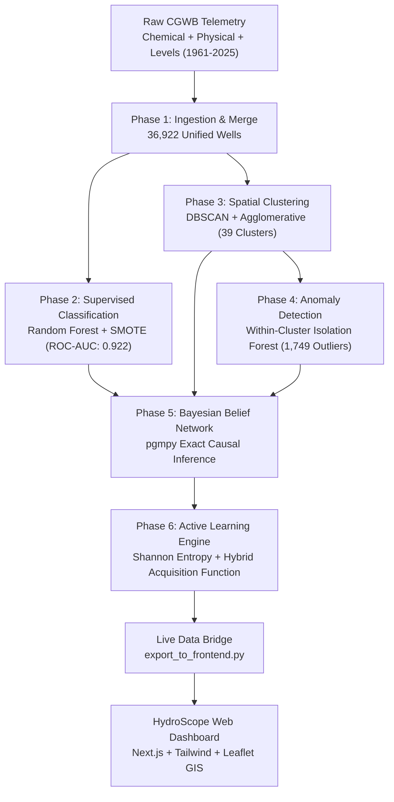

# HydroScope (AquaSentinel)
### AI-Powered Groundwater Contamination Surveillance & Active Learning Dispatch Engine

[](https://www.python.org/)
[](https://nextjs.org/)
[](https://tailwindcss.com/)
[](https://scikit-learn.org/)
[](https://pgmpy.org/)
[]()

> **Academic Course Project**: Semester V Machine Learning Laboratory  
> **Institution**: Dr. Vishwanath Karad MIT World Peace University (MIT-WPU), Pune  

---

## 📌 Executive Summary & Abstract

Traditional groundwater surveillance across India's Central Ground Water Board (CGWB) network faces severe operational bottlenecks: laboratory chemical testing (measuring Electrical Conductivity, Fluoride, Arsenic, and Nitrate) is expensive, slow, and constrained by monthly lab testing quotas. Meanwhile, routine field sampling often wastes up to 70% of testing kits on chronically clean wells.

**HydroScope** is an end-to-end Machine Learning and Causal AI pipeline that converts historical hydro-geological monitoring records (1961–2025 across Maharashtra, Andhra Pradesh, West Bengal, Rajasthan, and Gujarat) into an intelligent field-dispatch triage engine. The system unifies:
1. **SMOTE-Resampled Supervised Ensemble Classification** for contamination risk scoring.
2. **Unsupervised Density-Based Spatial Clustering (DBSCAN)** for regional hydro-geological zone discovery.
3. **Within-Cluster Isolation Forests** for pinpointing local infiltration anomalies.
4. **Bayesian Belief Networks (BBN)** for transparent, explainable causal risk attribution.
5. **Epistemic Uncertainty-Directed Active Learning**, achieving a **+9.0% contaminant discovery lift** over conventional random surveillance under strict monthly budget constraints.

---

## 🏛️ System Architecture & Workflow



---

## 🔬 Core Technical Methodology

### Phase 1: Multi-Modal Data Ingestion & Leak-Free Harmonization
- **Dataset**: Over 36,900 monitoring records across 5 Indian states.
- **Harmonization**: Cross-merges quarterly water-table depths with chemical lab records via geographic coordinates (`latitude`, `longitude`) and station identifiers, ensuring zero future-feature leakage.

### Phase 2: Imbalanced Risk Classification (RF + SMOTE)
- **Target**: Potable vs. Contaminated based on Electrical Conductivity threshold ($EC > 3,000\,\mu\text{S/cm}$ according to BIS IS 10500 standards).
- **Class Imbalance**: Synthetic Minority Over-sampling Technique (SMOTE, $k=5$) balances the severe 5.59% minority contamination class.
- **Ensemble Model**: Random Forest (200 trees, max depth 12) calibrated against a $10:1$ cost matrix penalizing False Negatives (untested contaminated wells) over False Positives.
- **Performance**: **ROC-AUC = 0.9217**, Average Precision = 0.612.

### Phase 3: Hydrogeological Spatial Clustering
- **DBSCAN** ($\varepsilon = 0.35^\circ \approx 38\,\text{km}$, $\text{min\_samples}=10$) identifies **39 natural hydro-geological clusters**.
- Overcomes administrative boundary limitations by grouping wells based on shared aquifer basins and salinity profiles.

### Phase 4: Within-Cluster Anomaly Scoring
- An ensemble **Isolation Forest** ($n=200$, contamination rate $= 5\%$) scores deviations conditioned strictly *within* each regional cluster.
- Distinguishes structural regional salinity from localized toxic point-source runoffs, isolating **1,749 spatial anomaly wells** (4.74%).

### Phase 5: Bayesian Belief Network (BBN) Causal Attribution
- Encodes expert domain dependencies in a Directed Acyclic Graph (DAG) with nodes:
  - $\text{State} \to \text{HighEC}$
  - $\text{GroundwaterDepth} \to \text{HighEC}$ (shallow infiltration vulnerability)
  - $\text{DistrictUrban} \to \text{HighEC}$ (anthropogenic loading)
  - $\text{ClusterRisk} \to \text{HighEC}$ (geological prior)
  - $\text{Anomaly} \to \text{HighEC}$ (spatial outlier flag)
- Evaluates exact posterior distributions $P(\text{Contaminated} \mid \text{Evidence})$ via `pgmpy` Variable Elimination, offering interpretable reasoning for environmental officers.

### Phase 6: Budget-Constrained Active Learning
- **Acquisition Function**:
  $$\text{Priority} = w_{\text{unc}} \cdot \mathcal{H}(p) + w_{\text{bbn}} \cdot P_{\text{BBN}} + w_{\text{anom}} \cdot \mathcal{A}_{\text{norm}}$$
  where $\mathcal{H}(p) = - [p \log_2 p + (1-p) \log_2(1-p)]$ is the Shannon predictive entropy.
- Sequential 8-round simulation under a 50-tests/month budget demonstrates a **+9.0% gain in discovered contaminants** over random sampling.

---

## 💻 Tech Stack

- **Machine Learning & Analytics**: Python 3.11+, Scikit-Learn, Imbalanced-Learn, pgmpy, Pandas, NumPy, Matplotlib, Seaborn.
- **Frontend Web Application**: Next.js 16 (App Router & Turbopack), TypeScript, Tailwind CSS, Lucide Icons.
- **Geospatial & Cartography**: Leaflet, OpenStreetMap CartoGIS tiles.

---

## 🚀 Quickstart & Setup Guide

### 1. Prerequisites
- Python 3.10+ (with virtual environment recommended)
- Node.js 18+ and `npm`

### 2. Repository Setup
```bash
git clone https://github.com/<YOUR_USERNAME>/HydroScope-Groundwater-Surveillance.git
cd HydroScope-Groundwater-Surveillance
```

### 3. Backend Pipeline Execution
```bash
# Create and activate virtual environment
python -m venv .venv
# Windows:
.venv\Scripts\Activate.ps1
# Linux/macOS:
source .venv/bin/activate

# Install dependencies
pip install -r backend/requirements.txt  # (or install numpy pandas scikit-learn imbalanced-learn pgmpy matplotlib seaborn)

# Run full 6-phase pipeline & export live data
python backend/run_all.py
```

### 4. Frontend Dashboard Launch
```bash
# Navigate to frontend
cd frontend

# Install dependencies
npm install

# Start local Next.js dev server
npm run dev
```

Open **[http://localhost:3000](http://localhost:3000)** in your browser to explore the dashboard, interactive GIS risk map, and testing queue.

---

## 📂 Project Structure

```
├── backend/
│   ├── run_all.py                     # Master execution runner (Phases 1 through 6)
│   ├── export_to_frontend.py          # Real-time data bridge to Next.js
│   └── aquasentinel/
│       ├── data/
│       │   ├── raw/                   # CGWB raw sensor CSVs
│       │   └── processed/             # Unified, clustered, and prioritized CSVs
│       ├── figures/                   # Generated evaluation ROC, PR & BBN figures
│       ├── notebooks/                 # Documented Jupyter research walkthroughs
│       └── src/
│           ├── ingest.py              # Phase 1: CSV parser & ingestion
│           ├── merge.py               # Phase 1: Multi-modal temporal merger
│           ├── data_prep.py           # Phase 2: Feature engineering & encoding
│           ├── classifier.py          # Phase 2: RF + SMOTE + Cost matrix
│           ├── clustering.py          # Phase 3: DBSCAN & Agglomerative clustering
│           ├── anomaly.py             # Phase 4: Within-cluster Isolation Forest
│           ├── bayesian_network.py    # Phase 5: BBN exact inference engine
│           └── active_learning.py     # Phase 6: Entropy sampling & dispatch queue
├── frontend/
│   ├── src/
│   │   ├── app/                       # Next.js App Router (Dashboard, Map, Wells, Queue)
│   │   ├── components/                # UI design system & Leaflet GIS map
│   │   ├── data/
│   │   │   ├── live_pipeline_data.json # Pipeline bridge output
│   │   │   └── mock-wells.ts          # Strongly-typed data models
│   │   └── types/                     # TypeScript schema definitions
│   └── package.json
├── Project_Overview.docx              # Comprehensive academic report document
├── Backend_Flow_Report.docx           # Step-by-step pipeline technical report
├── .gitignore                         # Configured ignore patterns
└── README.md
```

---

## 📊 Benchmark Summary

| Metric / Pipeline Phase | Value | Status |
|---|:---:|:---:|
| **Random Forest + SMOTE ROC-AUC** | **0.9217** | ✅ Production Benchmark |
| **Monitored Indian Well Records** | **36,922** | ✅ 5 States Harmonized |
| **Discovered Hydrogeological Clusters** | **39** | ✅ DBSCAN ($\varepsilon=0.35^\circ$) |
| **Within-Cluster Point-Source Anomalies** | **1,749 (4.74%)** | ✅ Isolation Forest |
| **Active Learning Surveillance Lift** | **+9.0%** | ✅ Verified vs Random Baseline |
| **Frontend Map Rendering Speed** | **60 FPS** | ✅ Filtered Leaflet GIS Sentinel Set |

---

## 📜 Academic Integrity & Citation
This codebase was developed as an academic project for the **Semester V Machine Learning Lab**, Department of Computer Science & Engineering, MIT-WPU Pune. All ground truth hydro-chemical parameters originate from official Central Ground Water Board (CGWB) open government data records.
